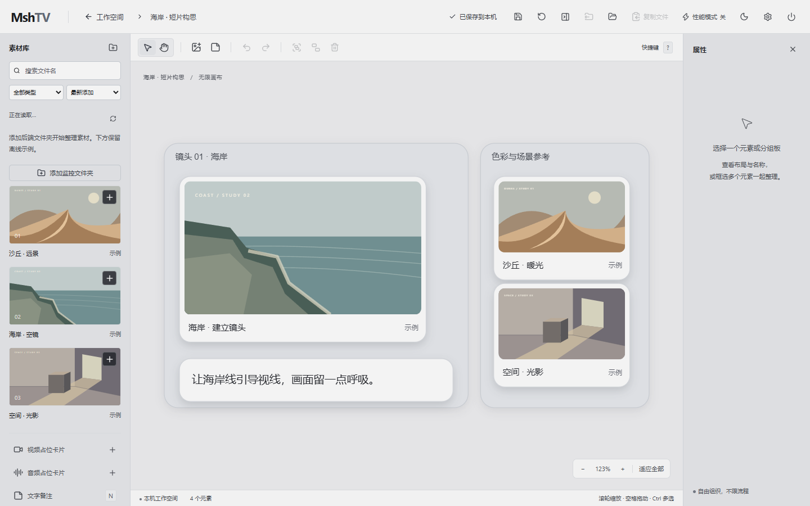

# MshTV

**在一张自由画布上整理图片、视频、录音和镜头备注。**

MshTV 是面向影视创作和个人素材整理的本地工作台。由 Windows 主机管理项目和文件，你可以在本机打开工作空间，也可以从局域网里的 Mac、Windows 或平板进入同一个浏览器界面。项目数据保存在自己的主机上，日常使用无需云服务或互联网。

> **使用须知**
>
> 本程序由 AI 制作完成。虽经过测试，仍无法保证 100% 的稳定性。请勿将它作为专业生产力软件来管理宝贵素材。重要项目和原始文件请另外保留独立备份。

## 下载与启动

**[下载 Windows x64 安装包](https://github.com/mushanghan/MshTV/releases/download/v0.9.3/MshTV-Setup-0.9.3-win-x64.exe)** · [版本与校验文件](https://github.com/mushanghan/MshTV/releases/tag/v0.9.3)

安装包约 105 MiB，支持 Windows 10 21H2 及更新版本。

1. 运行安装包，选择程序和项目数据的位置。升级时使用现有项目数据目录。
2. 打开 **MshTV 启动管理中心**，点击 **启动 MshTV**，浏览器会打开工作空间。
3. 新建一张画布，拖入图片、视频或音频，或在素材库添加要监控的 Windows 文件夹。

安装包包含 .NET 运行时、FFmpeg 和 ffprobe。安装后即可离线生成缩略图、视频封面和音频波形。视频与音频播放使用浏览器支持的格式。

## 用它做什么

| 功能 | 使用场景 |
| --- | --- |
| 自由画布 | 摆放素材、添加备注、整理镜头组。重开画布时恢复上次的视角。 |
| 工作空间 | 独立画布拥有各自的素材库。同一个画布组下的画布共享素材库。 |
| 文件夹监控 | 监控 Windows 主机上的目录，按需选择扫描子目录或只收录之后新增的文件。 |
| 媒体预览 | 查看图片和视频封面，在画布中播放视频、试听音频和查看波形。 |
| 素材输出 | 按画布分组复制原始素材到 Windows 文件夹，也可在 Windows 本机复制到文件剪贴板。 |
| 局域网访问 | 启用 HTTPS 并配对后，其他设备可通过浏览器打开和编辑主机上的工作空间。 |

监控目录中的原始素材以引用方式管理。浏览器直接拖入未登记的文件时，MshTV 会在项目数据目录保存一份导入副本。删除画布或库内记录时保留外部原件。

## 从 Mac 访问

目前可以从 Mac 浏览器访问 Windows 主机。在主机上进入「设置 → 局域网访问」，启用连接并按提示信任证书、配对设备即可。近期可能发布一个 **macOS 连接启动器**，帮助 Mac 更方便地连接 Windows 后端，发布时间待定。

## 源码与文档

- [使用与开发指南](docs/USER_GUIDE.md)涵盖本机运行、局域网配对、存储与备份。
- [架构说明](ARCHITECTURE.md)和[开发记录](DEVELOPMENT_PLAN.md)记载数据模型、文件保护和验证方式。
- [媒体组件构建与授权说明](docs/FFMPEG.md)提供内置工具的来源、构建参数和源码获取方式。

Windows 源码运行需要 Node.js 24 和 `global.json` 指定的 .NET 10 SDK。在项目根目录运行 `start.cmd`。前端使用 React、TypeScript 和 Konva，后端使用 ASP.NET Core 和 SQLite，Windows 启动器使用 WinForms。

## 许可

MshTV 源码采用 [MIT 许可证](LICENSE)。随包提供的第三方组件各自遵循其许可证，安装目录的 `licenses/` 包含分发说明和许可文本。
